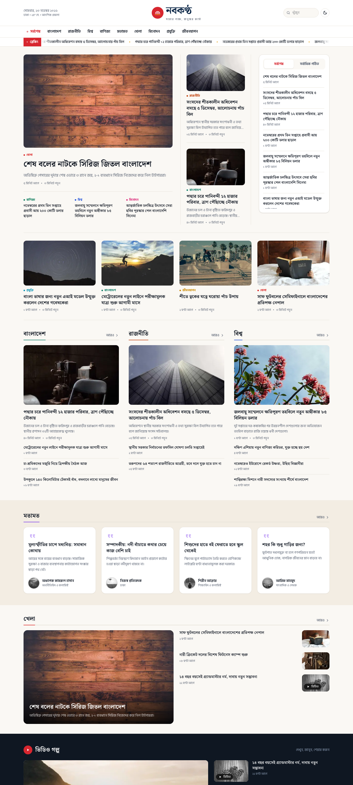
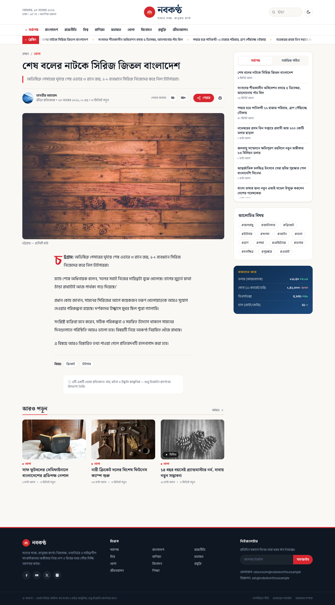
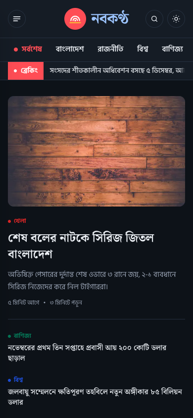
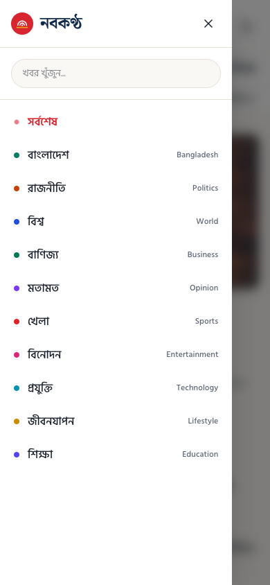

<div align="center">


# নবকণ্ঠ · Nobokontho

**সত্যের পক্ষে, মানুষের কণ্ঠে** — a modern Bangla news portal built with Next.js 16


</div>

---

## ✨ Overview

Nobokontho is a Bangla newspaper-style web app. Its layout follows the familiar structure of Bangla
dailies: a masthead with the date, a category nav, a lead story with a “সর্বশেষ / সর্বাধিক পঠিত”
sidebar, and category columns. The brand, colour palette, typography and most of the components are
original.

> [!NOTE]
> All articles, people and quotes in `src/lib/data.ts` are **fictional demo content**, written only
> to show off the design. Images are random placeholders from [picsum.photos](https://picsum.photos).

## 📸 Screenshots

| Home (desktop) | Article (desktop) |
| :---: | :---: |
|  |  |

| Mobile · dark mode | Mobile · menu |
| :---: | :---: |
|  |  |

## 🚀 Features

**Home page**
- Lead story, secondary stories, and a tabbed *Latest / Most read* panel
- Category columns for Bangladesh, Politics and World
- Opinion cards with author avatars, a Sports spotlight and a dark Video section
- Mini columns for Business, Entertainment, Technology and Lifestyle, plus an Education strip
- Breaking-news ticker that pauses on hover and respects `prefers-reduced-motion`

**Article page**
- Reading-progress bar, adjustable font size (অ− / অ+), Web Share with copy-link fallback, print
- Drop-cap opening, tags, related stories, and `NewsArticle` JSON-LD

**Site-wide**
- 🌙 Dark mode, saved to `localStorage` and applied before first paint (no flash)
- 📱 Mobile drawer menu (Esc to close, background scroll lock)
- 🔎 Search across titles, summaries, tags and locations
- 🔢 Bangla digits, dates and relative times ("৫ মিনিট আগে")
- 🔤 Hind Siliguri (body) and Noto Serif Bengali (headlines) via `next/font`
- 🧭 SEO: canonical URLs, Open Graph and Twitter cards, JSON-LD, `sitemap.xml`, `robots.txt`, RSS feed, web manifest and icons (see [SEO](#-seo))
- ⚡ Every category and article page is statically prerendered (Cache Components + Partial Prefetching)
- ♿ Skip link, ARIA tabs, labelled controls, `lang="bn"` markup

## 🗺️ Routes

| Route | Description |
| --- | --- |
| `/` | Home page |
| `/latest` | All stories, newest first |
| `/category/[slug]` | Category page (`bangladesh`, `politics`, `world`, `business`, `opinion`, `sports`, `entertainment`, `technology`, `lifestyle`, `education`) |
| `/news/[slug]` | Article page |
| `/search?q=` | Search |
| `/feed.xml` | RSS 2.0 feed of the latest 30 stories |
| `/sitemap.xml`, `/robots.txt`, `/manifest.webmanifest` | SEO / PWA metadata |

## 🛠️ Getting started

**Requirements:** Node.js 20.9 or newer.

```bash
npm install
npm run dev          # http://localhost:3000
```

| Script | What it does |
| --- | --- |
| `npm run dev` | Start the dev server (Turbopack) |
| `npm run build` | Production build |
| `npm start` | Serve the production build |
| `npm run lint` | Run ESLint |

### Environment

Copy `.env.example` to `.env.local` and set your production URL:

```bash
NEXT_PUBLIC_SITE_URL=https://your-domain.com
```

Canonical links, Open Graph URLs, the sitemap, robots.txt and the RSS feed are all built from this value.
If it is not set, it falls back to `http://localhost:3000`.

## 🔍 SEO

| What | Where |
| --- | --- |
| Title template, description, keywords, robots (`max-image-preview: large`) | `src/app/layout.tsx` |
| Canonical URL, Open Graph and Twitter card on every page | `pageMetadata()` in `src/lib/seo.ts` |
| Article meta: `og:type=article`, published time, section, tags, author | `src/app/news/[slug]/page.tsx` |
| JSON-LD: `NewsMediaOrganization`, `WebSite` with `SearchAction` | Home page |
| JSON-LD: `NewsArticle` / `OpinionNewsArticle` + `BreadcrumbList` | Article page |
| JSON-LD: `CollectionPage` with an `ItemList` + `BreadcrumbList` | Category page |
| Default share image (1200×630) | `src/app/opengraph-image.png`, `twitter-image.png` |
| `noindex, follow` on search results and 404 pages | `search/page.tsx`, `not-found.tsx` |
| Sitemap with `lastModified`, change frequency and image entries | `src/app/sitemap.ts` |
| RSS feed, advertised on every page with `<link rel="alternate">` | `src/app/feed.xml/route.ts` |

**Performance**
- Every page except search is prerendered at build time
- The lead image is preloaded with `fetchpriority="high"`; all other images are lazy-loaded
- Images are served as AVIF/WebP at responsive sizes and cached for 7 days
- Font weights are limited to the ones the design actually uses
- Client components only get the fields they need (e.g. the latest/most-read tabs get 4 fields, not full articles)
- Security headers are added and the `X-Powered-By` header is removed (`next.config.ts`)

## 📁 Project structure

```
src/
├── app/
│   ├── page.tsx                 # Home
│   ├── layout.tsx               # Fonts, theme script, header/footer shell
│   ├── category/[slug]/page.tsx
│   ├── news/[slug]/page.tsx
│   ├── latest/page.tsx
│   ├── search/page.tsx
│   ├── not-found.tsx
│   ├── icon.svg · favicon.ico · apple-icon.png
│   ├── opengraph-image.png · twitter-image.png
│   ├── feed.xml/route.ts        # RSS feed
│   └── sitemap.ts · robots.ts · manifest.ts
├── components/
│   ├── Header · Footer · Logo · MobileMenu · ThemeToggle · HeaderDate
│   ├── ArticleCards             # LeadCard, StoryCard, CompactCard, ListCard, HeadlineItem
│   ├── BreakingTicker · LatestTabs · Sidebar · SectionHeading · CategoryChip
│   ├── NewsImage · PageSkeleton · NewsletterForm · JsonLd
│   └── ReadingProgress · ArticleTools · BackToTop
└── lib/
    ├── data.ts                  # Demo dataset + query helpers
    ├── seo.ts                   # Metadata builder + JSON-LD helpers
    └── utils.ts                 # Bangla digit/date helpers, cn()
```

## 🎨 Design tokens

Colours are CSS variables in `src/app/globals.css`, with separate values for light and dark mode.
Tailwind exposes them as `bg-paper`, `text-ink`, `text-brand` and so on.

| Token | Light | Dark | Used for |
| --- | --- | --- | --- |
| `--brand` | `#d7262f` | `#ff4d55` | Accent, links, buttons |
| `--brand-ink` | `#0f2a4a` | `#9cc4ff` | Wordmark |
| `--gold` | `#e8a317` | `#f5b938` | Highlights |
| `--paper` | `#faf8f4` | `#0d1218` | Page background |
| `--surface` | `#ffffff` | `#151c25` | Cards |

Each category has its own accent colour in `categories` (`src/lib/data.ts`).

## 🔌 Connecting a real backend

Pages only use the helpers in `src/lib/data.ts`:
`getArticle`, `getArticlesByCategory`, `getLatest`, `getMostRead`, `getVideos`, `getRelated` and `searchArticles`.
Replace their bodies with calls to your CMS or API and keep the `Article` / `Category` types.

Cache Components is enabled, so data fetched at request time must be either:

- cached with the `"use cache"` directive (plus `cacheLife` / `cacheTag` for revalidation), **or**
- rendered inside a `<Suspense>` boundary.

To show real photos, add your image host to `images.remotePatterns` in `next.config.ts`.

## 📄 License

This is a demo / educational project. The content is fictional and is not affiliated with any real news organisation.
